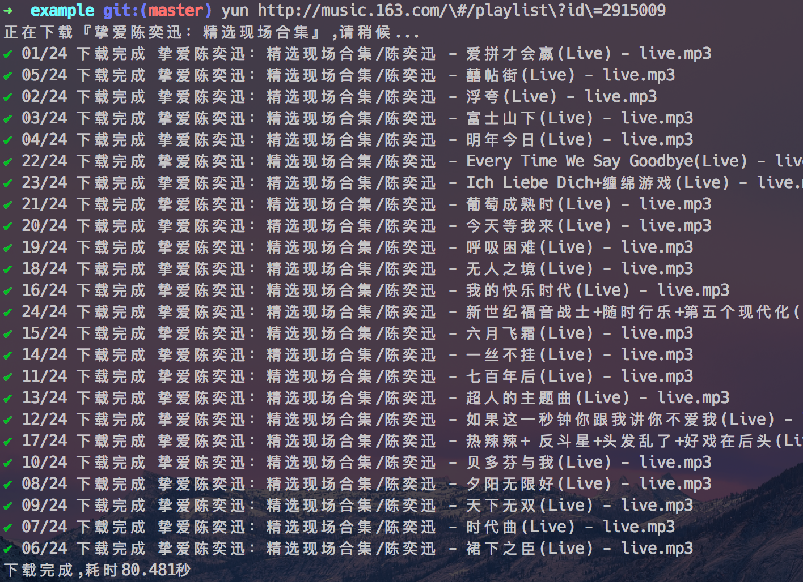

# yun-downloader

网易云音乐 歌单 / 专辑 / 电台 下载器

> 个人使用的网易云下载器：最高可用音质 + `-l/--lyric` 歌词下载
> （原词/译文按时间轴交错，首行作者标签 `[by:ZenithLiteAura]`）。

[](LICENSE)
[](#)

## 特性

- [x] 支持歌单 / 专辑 / 电台
- [x] 音质选择
- [x] 下载歌词, 原词/翻译按时间轴交错 (见 `-l, --lyric`)
- [x] 下载超时 / 重试
- [x] 再次下载默认跳过已下载部分, 使用 `content-length` 匹配
- [x] 自定义文件名
- [x] 下载进度显示

## 注意

本项目不支持越权使用, VIP 歌曲请开通 VIP 后结合 `--cookie` 使用.

## 安装

从本仓库安装（需要 Node.js >= 20）：

```sh
pnpm install
pnpm build

# 注册全局命令 yun（二选一）
pnpm link --global
npm i -g .
```

## 使用

```sh
Usage: yun <url> [options]

位置：
  url  歌单/专辑的链接                                                  [字符串]

选项：
      --retryTimeout  下载超时(分)                            [数字] [默认值: 3]
      --retryTimes    下载重试次数                            [数字] [默认值: 3]
      --cover         下载封面                            [布尔] [默认值: false]
      --cookie        cookie文件             [字符串] [默认值: "yun.cookie.txt"]
  -h, --help          显示帮助信息                                        [布尔]
  -v, --version       显示版本号                                          [布尔]
  -c, --concurrency   同时下载数量                                        [数字]
  -f, --format        文件格式                                          [字符串]
  -q, --quality       音质                                                [数字]
  -s, --skip          对于已存在文件且大小合适则跳过                      [布尔]
  -p, --progress      是否显示进度条                                      [布尔]
  -l, --lyric         下载歌词(.lrc)                           [布尔] [默认值: false]

示例：
  yun -c 10 <url>                          10首同时下载
  yun -f ":singer - :songName.:ext" <url>  下载格式为 "歌手 - 歌名"
  yun -l <url>                             同时下载歌词(.lrc)

帮助 & 文档: https://github.com/ZenithLiteAura/yun-downloader
```

### `--retry-timeout` 重试超时

设置下载超时, 单位为分, 默认 3 分钟

### `--retry-times` 重试次数

设置下载重试次数, 需要与 `--retry-timeout` 搭配使用,默认 3 次

### `--cover` 下载封面

默认不下载

### `--cookie` 已登录 cookie 存放地址

见 [docs/cookie.md](docs/cookie.md)

### `-c, --concurrency` 下载并发

下载并发

### `-f, --format` 自定义文件名

| token           | 含义                       | 备注       |
| --------------- | -------------------------- | ---------- |
| `:type`         | = `album` or `playlist`    |            |
| `:typeText`     | = `专辑` or `列表`         |            |
| `:name`         | 专辑名称 or 播放列表名称   |            |
| `:singer`       | 歌手名                     |            |
| `:songName`     | 歌名(aka 标题)             |            |
| `:albumName`    | 所属专辑                   |            |
| `:ext`          | 文件后缀,如 `mp3` 不带 `.` |            |
| `:index`        | `01` , `02` ... `12`       |            |
| `:rawIndex`     | `0` `1` ... `11`           |            |
| `:programDate`  | 电台节目发布日期           | 仅电台可用 |
| `:programOrder` | 数字, 电台第几期           | 仅电台可用 |

- 默认值 = `:name/:singer - :songName.:ext`
- 电台默认 = `:name/:programDate 第:programOrder 期 - :songName.:ext`

### `-q, --quality` 自定义下载音质

| 取值 | 含义       | 备注 |
| ---- | ---------- | ---- |
| 128  | 128kbits/s |      |
| 192  | 192kbits/s |      |
| 320  | 320kbits/s | 默认 |

### `-s, --skip` 是否跳过下载

- 对于文件已存在, 而且文件大小与要下载的网络文件的 `content-length` 大小一致, 则跳过下载
- 默认启用
- 使用 `--skip false` 关闭该特性

### `-p, --progress` 是否显示进度条

- 默认 `true`, 显示进度条, 使用 `false` 不显示进度条
- 使用了模块 [ascii-progress](https://github.com/bubkoo/ascii-progress), 问题比较多, 比如非 tty, 在控制台输入一些东西进度显示就乱了, 故提供选项关闭该特性

### `-l, --lyric` 下载歌词

- 默认 `false`, 开启后每首歌下载完成时一并下载歌词
- 歌词文件与音频文件**同目录同名**, 后缀换成 `.lrc`, 例如 `歌单/歌手 - 歌名.mp3` → `歌单/歌手 - 歌名.lrc`
- 歌词取自网易云该歌曲自身, 不依赖第三方歌词站; VIP 歌曲配合 `--cookie` 同样适用
- 文件格式:
  - 第一行是作者 tag: `[by:ZenithLiteAura]`
  - 原词与翻译按时间轴交错, 同一时间戳先原词、紧跟一行翻译; 没有翻译时只输出原词
  - 时间轴统一为 `[mm:ss.xx]`, 间奏的空时间轴保留

```
[by:ZenithLiteAura]
[00:00.00]作曲 : Ayase
[00:00.46]I leap out of the same routine I am living day by day
[00:00.46]我跳出日复一日的日程
[00:17.43]
[00:23.81]Greenery, shining view
[00:23.81]绿意盎然 风景优美
```

- 已存在且非空的 `.lrc` 默认跳过; 使用 `--skip false` 强制覆盖重写
- 纯音乐/无歌词歌曲只提示, 不生成文件, 不影响其它歌曲下载
- 也可写在 `.yunrc` 里: `{ "lyric": true }`

## `.yunrc`

该工具使用了 `rc` 模块, 会去遍历读取 `.yunrc` 配置文件
具体规则见 `rc` 模块 README https://github.com/dominictarr/rc#standards

## 截图



## 更新记录

[CHANGELOG.md](CHANGELOG.md)

## License

MIT License，Copyright (c) 2026 ZenithLiteAura（见 [LICENSE](LICENSE)）
